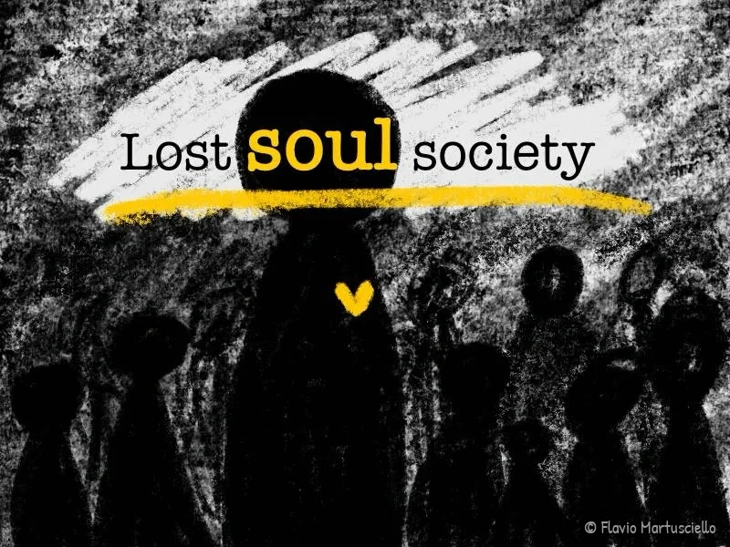
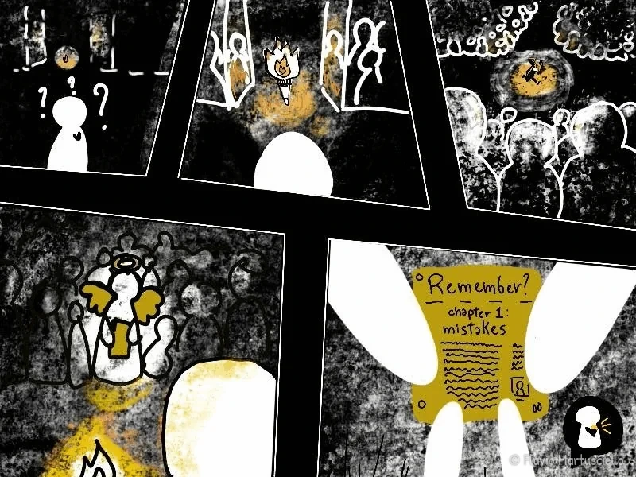
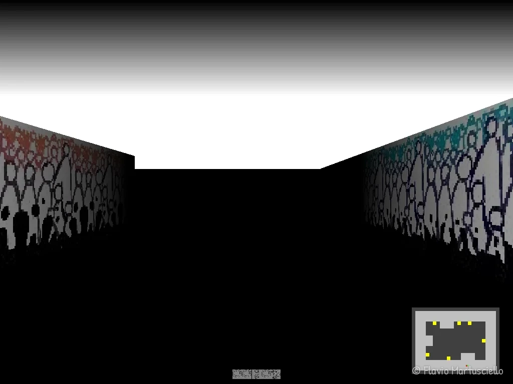
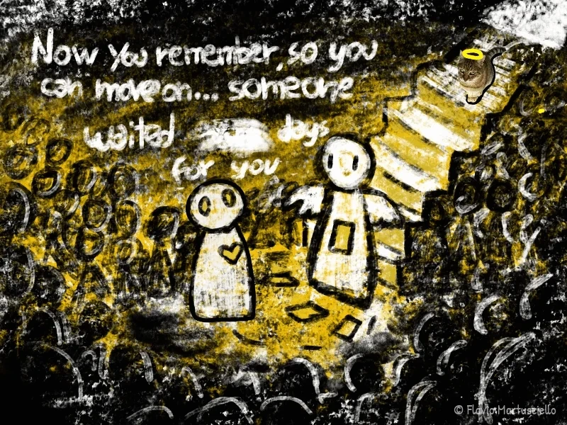

# Lost Soul Society

A first-person game in the style of the old Doom, made on my own in C with raycasting. It's my version of the cub3D project at 42 Roma Luiss.



## The story

A man dies and wakes up in a limbo. The only way out is to find the angels' doors: each one keeps a chapter of his life. If he remembers, he'll be saved.

The story is told with illustrated panels at the start. Then you're free to walk around the rooms looking for the doors. When they're all open the game ends and shows how long it took you.

| | |
|---|---|
|  |  |

## What's inside

- raycasting with textured walls, written from scratch on top of the 42 MiniLibX
- doors that open and close, with their sound
- an animated torch, a timer and a start and end screen
- background music and effects with SDL2_mixer
- a parser for `.cub` maps that checks textures, colours and closed walls

## Controls

| Key | Action |
|---|---|
| W A S D | move, and go on through the story panels |
| arrows, mouse wheel | turn |
| space | open or close a door |
| Esc | quit |

## Run it

On Linux you need the X11 and SDL2 libraries (Debian/Ubuntu: `sudo apt install libx11-dev libxext-dev zlib1g-dev libsdl2-dev libsdl2-mixer-dev`) and the MiniLibX in a folder called `mlx_linux`:

```bash
git clone https://github.com/42Paris/minilibx-linux.git mlx_linux
make -C mlx_linux
make
./cube3d map.cub
```

`map.cub` is the full game. `mapTEST.cub` is a tiny room I used for testing.


